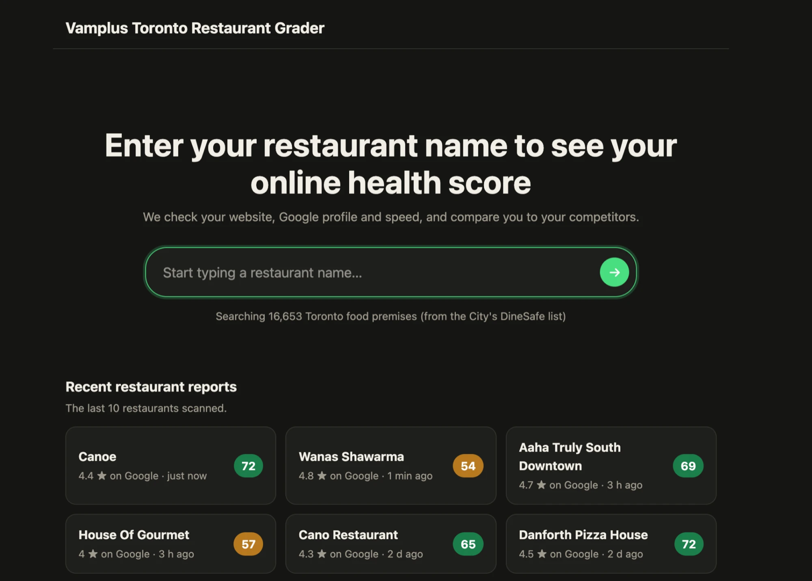
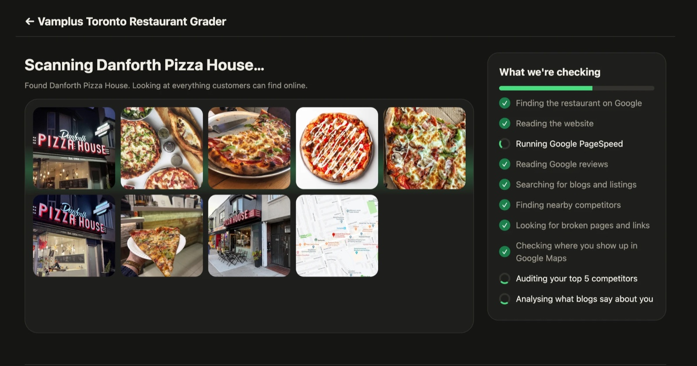
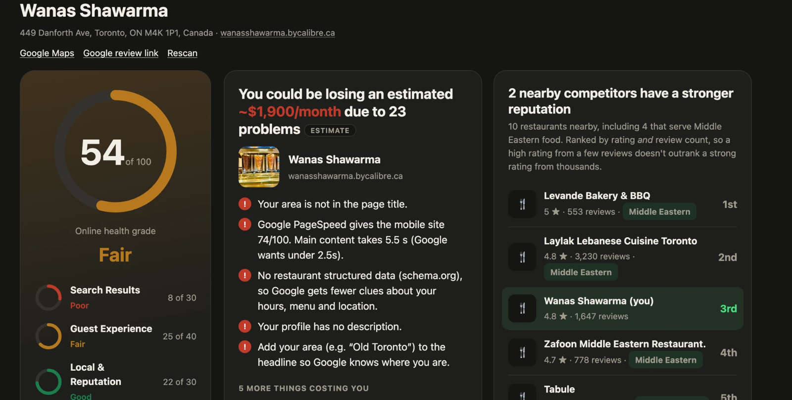

# Toronto Restaurant Grader

**A free "online health check" for Toronto restaurants.** Pick a restaurant, and in about 30 seconds get a score out of 100, a plain-language list of what to fix first, and a comparison with similar restaurants nearby.

**Live demo:** https://ahmedfayazwahab.ca/restaurantgrader/ (free beta)

> Scores, rankings and dollar figures are automated **estimates** built from public data. They are not facts, measurements of real sales, or professional advice. This project is not affiliated with Google, the City of Toronto, or any restaurant.



---

## What it does (in plain language)

When people look for a place to eat, they search Google, glance at ratings, and maybe open the restaurant's website. Many restaurants lose customers at those moments without knowing it: the website is slow, the hours are missing, the menu is a hard-to-read PDF, the Google listing is half empty, or nearby competitors simply look better online.

This tool is a health check-up for that online presence. It looks at what a customer would see, scores it, and explains what to improve.

**What a user does**

1. **Search** a restaurant name. About 16,600 Toronto restaurants are searchable, and the search forgives typos ("sooper hot pot" finds "Souper Hot Pot").
2. **Watch the scan.** A live progress screen shows the restaurant's real photos and a checklist ticking off.
3. **Read the report:**
   - an overall score and grade, with three sub-scores
   - the top problems, with a rough monthly dollar **estimate** of what they may cost
   - what the restaurant already does well
   - how it compares with nearby competitors, including ones serving the same cuisine
   - a summary of what guests say in Google reviews
   - blogs and press that mention it, with AI-written advice on improving

### What it looks like

**The live scan.** The restaurant's real photos appear while a checklist ticks off each step.



**The report.** A score out of 100 with three sub-scores, the top problems with a labelled dollar estimate, and a ranked list of nearby competitors, including the same cuisine.



*The screenshots show example output for real, public businesses.*

---

## How it works

```
Browser (plain HTML / CSS / JavaScript)
   |
   |  search, then a live scan streamed back with Server-Sent Events
   v
Node.js app  (runs locally, or as an AWS Lambda function)
   |
   |-- 1. Find the restaurant on Google Maps (Places API)
   |-- 2. Read its website, check speed (PageSpeed), crawl up to 12 pages for broken links
   |-- 3. Read Google reviews, then summarise them (OpenAI)
   |-- 4. Search the web for blogs, press and listings (Brave Search), then analyse them (OpenAI)
   |-- 5. Find nearby competitors, including the same cuisine, and audit the top five
   |-- 6. Score everything with fixed rules and write the report
   v
Report cached for reuse (local files, or S3 on AWS)
```

Key design points:

- **Scoring uses fixed rules, not AI**, so results are consistent. AI (OpenAI) only writes summaries, analyses blog coverage and suggests improvements, and is a fallback for detecting a restaurant's cuisine.
- **Fair competitor ranking.** Ratings are weighted by review count, so a 4.9 from 50 reviews does not outrank a 4.8 from 2,500: `weighted = (n / (n + 150)) * rating + (150 / (n + 150)) * 4.3`.
- **Same-cuisine competitors.** The app works out the restaurant's specific cuisine (for example "South Indian") from its name, Google summary, website and reviews, then searches for competitors of that cuisine as well as the nearest ones.
- **Honest about gaps.** If a website blocks the check, or too little can be measured, the score is marked **incomplete** instead of guessing. A check that could not run is left out, not counted as a failure.

---

## APIs and services used

| Service | What it is used for | Key needed |
|---|---|---|
| **City of Toronto Open Data: DineSafe** | The restaurant list (name, address, phone, location) | No |
| **Google Places API (New)**: Text Search, Place Details, Nearby Search, Place Photos | Restaurant profile, hours, rating, up to 5 reviews, photos, nearby competitors, same-cuisine search, Maps rankings | `GOOGLE_API_KEY` |
| **Google PageSpeed Insights API (v5)** | Mobile speed (Lighthouse) and text-contrast check | `PAGESPEED_API_KEY` |
| **Brave Search API** | Finds blogs, press articles and directory listings that mention a restaurant | `BRAVE_API_KEY` (optional) |
| **OpenAI Chat Completions API** (default model `gpt-4o-mini`) | Guest review summary, blog and press analysis with advice, cuisine detection fallback | `OPENAI_API_KEY` (optional) |
| **The restaurants' own websites** | Read and crawled to check titles, hours, menus, links and images. The bot identifies itself as `RestaurantGraderBot/1.0` | No |
| *Google Custom Search JSON API* (optional alternative to Brave) | Same job as Brave Search if you prefer it | `GOOGLE_CSE_ID` |

The app still runs without the OpenAI and Brave keys. Those sections show "not set up" and their points are left out of the score.

**AWS services (only for hosting):** Lambda (Node.js 22, Function URL with response streaming), CloudFront, S3, DynamoDB, CloudFormation and IAM. See [DEPLOY.md](DEPLOY.md).

**Libraries:** Node.js (ES modules) and [cheerio](https://cheerio.js.org/) for reading web pages. The frontend has no framework.

---

## What it checks, and the scoring

About 40 checks in three groups, scored out of 100. Some checks give partial credit.

**Search Results (30 points).** Can Google tell what and where the restaurant is?

| Check | Pts |
|---|---|
| Page title: includes area 4, matches Google profile name 3, includes a cuisine keyword 3 | 10 |
| Headline (H1): exists 1, includes area 2, includes keyword 2 | 5 |
| Meta description: length 2, includes area 1, includes keyword 2 | 5 |
| Image alt text 2, restaurant structured data 3 | 5 |
| Social sharing tags (Open Graph and Twitter card) | 2 |
| Domain: custom 1, one consistent address 2 | 3 |

**Guest Experience (40 points).** Does the website turn visitors into guests?

| Check | Pts |
|---|---|
| Fast mobile speed | 4 |
| Mobile-friendly, nothing broken (pages, images, insecure links), no off-site ordering, order or reserve button, hours on the homepage | 3 each |
| Enough text, phone number, social links, address, cuisine keywords, readable text menu, About section, customer reviews on the site, direct-ordering message | 2 each |
| Favicon, FAQ, text contrast | 1 each |

**Local & Reputation (30 points).** How strong is the Google listing and the restaurant's reputation?

| Check | Pts |
|---|---|
| Google profile: website linked, description, hours | 3 each |
| Google profile: phone, price range, service options, category matches the website | 2 each |
| Review rating and volume | 3 |
| Guest sentiment (from the AI review summary) | 4 |
| Listed on Yelp and TripAdvisor | 3 |
| Blog and press coverage | 3 |

**Grades:** Good 65 and up, Fair 45 to 64, Poor under 45. These cut-offs came from a small sample of about 20 restaurants, so they are provisional. See [scripts/calibrate.js](scripts/calibrate.js) to re-run the calibration.

**The dollar estimate** is deliberately rough and its assumptions are shown in every report: about 2% of guests leave a Google review (to guess monthly guests from the review count), about 40% of guests find or choose a restaurant online, and fixing everything might win back up to 30% more of them, scaled by how far the score is from 100. The result is shown as a range of plus or minus 50%.

---

## Run it locally

You need Node.js 22 or newer.

```bash
git clone https://github.com/ahmedfayazwahab/toronto-restaurant-grader.git
cd toronto-restaurant-grader
npm install
cp .env.example .env      # then add your own API keys
npm start                 # open http://localhost:3000
```

You need at least `GOOGLE_API_KEY` (Places API (New) enabled) to scan restaurants. Add `PAGESPEED_API_KEY`, `OPENAI_API_KEY` and `BRAVE_API_KEY` for the full report. **Never commit your `.env` file.** It is git-ignored.

Reports are saved as JSON files under `data/` and reused for 24 hours.

### Rebuilding the restaurant list

`data/establishments.json` is included so the app works out of the box. To refresh it from the City's open data:

```bash
python3 scripts/fetch_dinesafe.py     # downloads DineSafe, writes data/establishments.raw.json
node scripts/dedupe.js                # merges duplicates, hides obvious non-restaurants, writes data/establishments.json
```

### Other scripts

- `node scripts/calibrate.js 30` scans a random sample of restaurants and shows how scores are spread (spends API credit).
- `bash scripts/package.sh` builds the AWS Lambda zip.

---

## Hosting on AWS

The live version runs as a serverless backend (Lambda) behind CloudFront, with the static pages in S3, cached reports in a private S3 bucket and daily scan counters in DynamoDB. [`infra/template.yaml`](infra/template.yaml) creates the backend, and [DEPLOY.md](DEPLOY.md) is a click-by-click guide, including cost-protection steps.

---

## Safety, privacy and cost control

- **No secrets in this repository.** API keys live in environment variables (`.env` locally, Lambda environment variables on AWS). The `.gitignore` excludes `.env`, secrets, saved reports and AWS config.
- **Usage limits:** by default 8 new scans per visitor per day and 80 per day overall (`LIMIT_SCANS_PER_IP_PER_DAY`, `LIMIT_SCANS_PER_DAY`). Viewing an already-scanned report is free, and a failed scan gives the allowance back. Set spending caps with each API provider as well.
- **Locked-down backend on AWS:** the Lambda only answers requests that carry a secret header added by CloudFront.
- **Privacy:** no accounts, no cookies, no analytics. Visitor IP addresses are used only for the daily limit and stored only as one-way hashes for about two days.
- **Pages for visitors:** Terms of use, Privacy policy and Data sources & credits are in [`public/`](public/). They are drafts written for this project and are not legal advice, so have them reviewed before relying on them.

---

## Project layout

```
app.js                  The app core: routes, scan jobs, caching, usage limits
server.js               Local development server
lambda.js               AWS Lambda entry point (streaming)
lib/
  analyze.js            Orchestrates a scan; scoring rules; competitors; rankings
  crawl.js              Website crawl, menu check, structured-data check
  cuisine.js            Detects a restaurant's specific cuisine
  coverage.js           Reads blogs and press, then writes AI advice
  reviews.js            AI summary of guest reviews
  websearch.js          Brave Search (or Google Custom Search): blogs and listings
  strength.js           Review-weighted rating
  estimate.js           The labelled dollar estimate and its assumptions
  fuzzy.js              Typo-tolerant restaurant search
  grade.js, limits.js, store.js, env.js
public/                 The website: index, report, terms, privacy, credits, style
scripts/                Data download and dedupe, calibration, packaging, site upload
infra/                  CloudFormation template, CloudFront function, example IAM policy
data/                   establishments.json (the restaurant list) and grades.json
DEPLOY.md               Step-by-step AWS deployment guide
docs/screenshots/       Screenshots used in this README
```

---

## Known limitations

- It is a **free beta**, not a finished product.
- The scoring weights are the author's own design and have not been validated against real business outcomes.
- Google returns at most 5 reviews per restaurant, so the review summary is based on a small sample.
- Some sites block automated checks, and the report says so (an incomplete score).
- The City's list includes some places that are not restaurants (child-care centres and similar). The filter catches most but not all.
- Map ranking figures are approximate: they come from Google Places search results, not the exact map pack a customer sees.
- AI-written text can contain mistakes.

---

## Credits and data licences

- **Restaurant list:** City of Toronto, [DineSafe](https://open.toronto.ca/dataset/dinesafe/). Contains information licensed under the [Open Government Licence – Toronto](https://open.toronto.ca/open-data-licence/). The file `data/establishments.json` is derived from that dataset (name, address, phone and location only, with duplicates merged). It is not endorsed by the City of Toronto.
- **Business information** (profiles, ratings, reviews, photos) comes from the Google Maps Platform at scan time. No Google-sourced business data is stored as data files in this repository. The screenshots in `docs/screenshots/` show example output for real, public businesses.
- **Web search:** Brave Search API. **AI text:** OpenAI.
- Built with [Claude Code](https://claude.com/claude-code).

## Licence

No licence has been chosen yet, so by default all rights are reserved. The code is public for viewing. Contact the author before reusing it.
